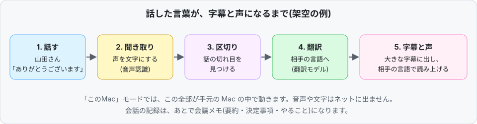
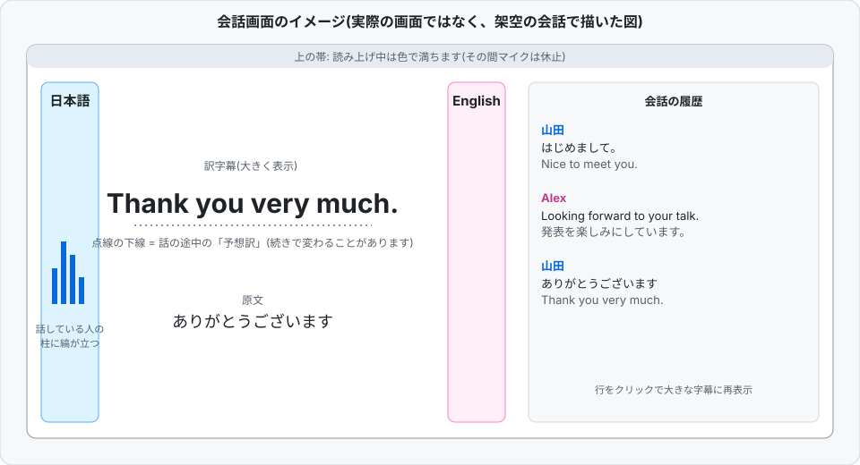
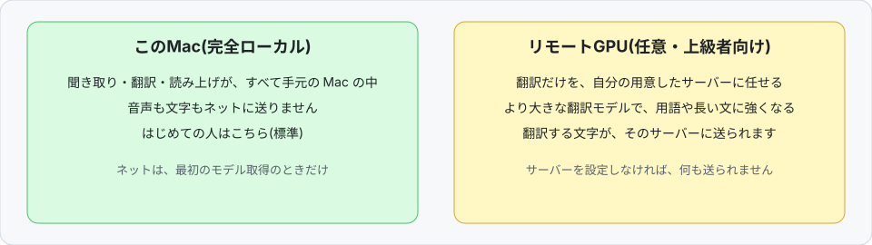

# Sokutsu (即通, "soku-tsū")

[](LICENSE)
[-lightgrey.svg)](#requirements)

[日本語](README.md) | English


## What is this?

**When you talk face to face with someone who speaks another language, Sokutsu listens on your Mac and gives you the other language as large captions and a spoken voice.** What was said is also turned into meeting notes automatically. It works on your own Mac without sending audio to the internet (Apple silicon Macs only; free, open source).

For example, a Japanese speaker and an English speaker sit around one Mac, and it translates both sides on the spot, showing big captions and reading them aloud.



> No screenshots are included because they would show real utterances. The conversation in the figures (Yamada and Alex) is made up. The figures are in Japanese.

The Japanese README is the primary one and is more detailed.

## Contents

- [What you can do](#what-you-can-do)
- [What the screen looks like](#what-the-screen-looks-like)
- [Getting started (for first-timers)](#getting-started-for-first-timers)
- [FAQ](#faq)
- [Plain-language glossary](#plain-language-glossary)
- [For those who want to know more](#for-those-who-want-to-know-more) (features, requirements, usage, how it works, measured results, privacy, limitations, development, license, roadmap)

## What you can do

**Talking with an exchange student or an overseas guest**
- Take turns speaking face to face; captions in the other person's language appear in large type.
- It can also read the translation aloud, so you can follow by listening.

**Q&A at an international conference, or a chat in the hallway**
- Questions and answers become captions on the spot. Put names and technical terms in the "term dictionary" to reduce mishearing and inconsistent translations.

**Multilingual meetings**
- What was said is recorded, and after the meeting you get notes: summary, decisions, to-dos (you pick the meeting type).
- Ask questions about the record, or export it as PDF, Word, or subtitle files.

Supported languages: Japanese, English, Chinese, Korean (you pick any two of them).

## What the screen looks like



- The pillars on the left and right are the two languages; the speaker's pillar moves.
- The middle shows the big translated caption and the original. A dotted underline marks a *predicted* translation made while the person is still talking.
- The right side keeps the conversation history.

## Getting started (for first-timers)

### Easiest: download the app (recommended)

1. Download `Sokutsu-1.1.3.dmg` from the [Releases page](https://github.com/hamadareo/sokutsu/releases/latest).
2. Open the DMG and drag `Sokutsu.app` into Applications.
3. **First launch only:** right-click `Sokutsu.app`, choose "Open", then click "Open" again in the dialog (see the note below).
4. On the first screen, the app downloads the translation and speech models (about 3.4 GB) with a progress bar, and can resume if interrupted. If you already have the models, choose "Choose folder" and it will skip the download.

> **"Cannot verify the developer" is not a malfunction.** The app is not Apple-notarized (that needs a paid developer account). All source code is public on this page and you can build the same DMG yourself with `scripts/build_dist.sh`. Use right-click > Open if you decide to trust it.

You need: an Apple-silicon Mac (M1 or later), macOS 13.3+, about 5 GB free disk, and internet for the first model download. No Python or LM Studio required.

To run from source instead, read on.

### Running from source

### 1. What you need

- An Apple silicon Mac (M1 or later), macOS 13.3 or later
- 16 GB memory recommended, about 5 GB free disk
- An internet connection (**only the first time, to download models**; not needed for conversations afterwards)
- Python 3.10 or later, and the translation app [LM Studio](https://lmstudio.ai)



### 2. Install

Open Terminal (Applications > Utilities > Terminal) and paste the lines one at a time, pressing Enter after each.

```sh
git clone https://github.com/hamadareo/sokutsu.git
```
-> Downloads the app's source code.

```sh
cd sokutsu
```
-> Moves into the downloaded folder.

```sh
python3 -m venv .venv
```
-> Creates a private Python environment for this app.

```sh
.venv/bin/pip install -r requirements.txt
```
-> Installs the required libraries into that environment.

```sh
bash scripts/get_models.sh
```
-> Downloads the listening, splitting and speaking models (about 2 GB in total). First time only.

### 3. Prepare translation (LM Studio)

1. Install and open [LM Studio](https://lmstudio.ai).
2. Download a Gemma 3 4B-class model.
3. Start its server (port 1234).

### 4. Launch

```sh
./run.sh
```
-> Starts the app. On first launch macOS asks for microphone access; choose "Allow".

### 5. What to choose on the first screen

1. **Language pair**: the two languages the two people speak (e.g. Japanese and English).
2. **Where to translate**: first-timers should choose **"This Mac"**. "Remote GPU" is for people who have their own server. "Auto" tries the remote first and falls back to this Mac.
3. **Sound to listen to**: "Mic only" for face to face; "Mic + this Mac's sound" if you also want to translate the other side of an online meeting (macOS 14.2+).
4. Optionally fill in topic, names, terms and meeting type, then press **"Start"** (the button is labelled "会話を始める" in Japanese).

### If it does not work

- **Nothing is translated / an error appears**: make sure a model is loaded in LM Studio and its server (port 1234) is running before `./run.sh`.
- **The mic does not respond**: in System Settings > Privacy & Security > Microphone, allow Terminal.
- **The Japanese voice is the plain macOS voice**: that is what happens without the optional voice engine (VOICEVOX); it is not a fault. See "Getting started (details)" below.
- **"This Mac's sound" is unavailable**: it needs clang (`xcode-select --install`). Mic-only works without it.
- **Slow**: 8 GB memory works but is slower (16 GB recommended).
- See also "Limitations" below.

## FAQ

**Is it free?**
Yes. The source code is MIT-licensed. The models it uses have their own terms (e.g. Gemma: Google's Gemma Terms of Use); see [THIRD_PARTY_NOTICES.md](THIRD_PARTY_NOTICES.md).

**Is my audio sent over the internet?**
Not in "This Mac" mode. The network is used only to download models. No cloud API is used. Only if you choose "Remote GPU" is the text being translated (and audio, if you use the remote ear) sent to the server you specify.

**Which languages are supported?**
Japanese, English, Chinese and Korean. You pick two of them; other languages heard are shown as captions only.

**How accurate is it?**
As a rough guide: translation quality (chrF) over 12 directions among the four languages was 39.03 / 39.34 on This Mac (two runs) and 45.03 / 45.06 with Remote GPU (a larger model). The share of glossary terms that appeared in translations was 93.6% on This Mac. On COMET, a metric closer to how a person would judge quality, the mean was 87.83. **These were measured on the developer's Mac (mostly M3 / 16 GB) and vary with hardware and conditions.** It is weak on real meetings with several people overlapping; it is built for face-to-face turn-taking. See "Measured results".

**How fast is it?**
As a rough guide, Japanese to English: the translation was final a median of about 0.85 s after the end of speech, and the voice started at about 1.56 s (measured on the developer's Mac).

**Does it work on Windows or iPhone?**
No. It is for Apple silicon Macs only (not Windows, Linux or Intel Macs).

**What is "Remote GPU"?**
An optional, advanced feature that hands only the translation to another computer you prepare (a server with a GPU). A larger model can be used, which helps with technical terms and long sentences. If you do not set it up it is not used and nothing is sent.

**Can I use it in online meetings (Zoom etc.)?**
Yes. Choose "Mic + this Mac's sound" to translate the other side too (macOS 14.2+). Because the mic pauses while the app speaks, "captions only" is recommended for online meetings.

**Where are conversation records kept?**
Only on this Mac (the `logs/` folder when run from source). They are not sent anywhere and are excluded from Git. You can also choose not to keep recordings.

## Plain-language glossary

| Term | Meaning |
|---|---|
| Speech recognition (the "ear") | Turns voice into text. This app uses SenseVoice or Whisper. |
| Translation model | An AI that translates text. This app uses a large language model (LLM) such as Gemma 3 4B. |
| Predicted translation | A provisional translation shown while the person is still talking; replaced by the final one when they stop. |
| VAD | Finds where speech starts and stops, to split the talk into segments. |
| Quantization (QAT / Q4_0) | A way to shrink an AI model so it runs fast in less memory. |
| chrF, COMET | Scores for translation quality. chrF measures character overlap with a reference; COMET uses an AI to judge meaning. Higher is better. |
| WER | Word error rate: the share of recognized words that were wrong. Lower is better. |
| Remote GPU | A separate server you prepare to take over translation. |
| OpenAI-compatible server | A standard interface, offered by tools such as LM Studio, for calling a translation model. It runs locally and is unrelated to the cloud OpenAI service. |
| SSH | An encrypted connection to another computer, used to reach the Remote GPU. |

---

## For those who want to know more

The rest is detail on how it works, evaluation, and development.

### Features

- Captions first: big translated caption + original text + a conversation history rail. A dotted-underline *predicted* translation appears while the speaker is still talking and is finalized when they stop.
- Spoken translation with per-language voice and speed; an automatic pace mode adapts speaking speed to the speaker. The mic pauses while the app speaks (use "captions only" for online meetings).
- Automatic language detection; built-in glossary (ja/en/zh/ko) plus your own term dictionary to fix misheard acronyms and names.
- Meeting notes with templates (regular meeting, 1:1, sales, interview, lecture, brainstorm, Q&A): summary, decisions, action items, speaker names, all with a local LLM. Ask questions about one or all meetings, with source lines cited.
- Library with folders, tags, stars and search. Export to PDF, Word (.docx), Markdown, and subtitles (SRT / WebVTT). Import audio/video files (m4a, mp3, wav, mp4, mov, ...) to get transcripts, speakers and notes.
- Speaker separation and "remember voices" (voice features stay on this Mac). Optionally hear the other side of an online meeting ("Mic + this Mac's sound", macOS 14.2+).
- Calendar / Reminders integration only when you press the buttons. UI in Japanese, English, Chinese, Korean.

### Requirements

- Apple silicon Mac (M1 or later), macOS 13.3 or later (14.2+ for capturing the other side of online meetings)
- 16 GB memory recommended (8 GB works, slower); about 5 GB free disk (models are about 3.4 GB)
- From source: Python 3.10+ (tested on 3.10) and clang (`xcode-select --install`, used to build a small system-audio helper; optional)
- A translation engine: for "This Mac" when running from source, an OpenAI-compatible server on port 1234 (e.g. [LM Studio](https://lmstudio.ai) with a Gemma 3 4B model). A DMG you build yourself bundles llama.cpp's `llama-server` + Gemma 3 4B instead.

### Getting started (details)

A prebuilt app (DMG, ad-hoc signed, not notarized) is on the [Releases page](https://github.com/hamadareo/sokutsu/releases/latest). You can also run from source or build your own DMG.

```sh
git clone https://github.com/hamadareo/sokutsu.git
cd sokutsu
python3 -m venv .venv
.venv/bin/pip install -r requirements.txt
bash scripts/get_models.sh   # speech / VAD / TTS models from their official sources (first time only)
./run.sh                     # start your OpenAI-compatible server on port 1234 first
```

- Optional Japanese voice: [VOICEVOX ENGINE](https://voicevox.hiroshiba.jp/) unpacked in `~/voicevox` (override with `VOICEVOX_HOME`); otherwise macOS `say` is used.
- **Remote GPU (optional)**: run an OpenAI-compatible LLM server on a machine you control, make it reachable over key-based SSH, then `TSUYAKU_SSH=user@host ./run.sh`. `scripts/remote_tunnel.sh` sets up the SSH port forward; pick "Remote GPU" or "Auto" on the start screen. Optionally `server/remote_stt_server.py` (faster-whisper) can also run speech recognition remotely; in that case the audio being translated is sent to that server over SSH.
- Build a DMG: `bash scripts/build_dist.sh` (models are downloaded on first launch from official sources and verified by SHA256).

### Usage (details)

Pick a language pair (optionally topic / names / terms, a term dictionary, a meeting type) on the start screen and press "Start". Main keys: `Space` or click a caption = stop speaking and listen again; `Esc` = cancel / quit; `-` `+` = caption size; `V` = voice on/off; `B` then `1`-`4` = mark the current line (important / decision / to-do / question); `M` = write a note; `?` = cheat sheet. Right-click rows and items in meeting views to fix text, change speakers, mark or delete (`⌘Z` to undo).

### How it works

```
mic / system audio -> auto gain -> Silero VAD -> ear (SenseVoice / Whisper / optional remote faster-whisper)
   -> term fixing (glossary) -> translation LLM (predicted -> final) -> captions + TTS (Kokoro / VOICEVOX / macOS say)
   \-> local log -> meeting notes / Q&A / export
```

### Measured results

Measured during development, mostly on an M3 / 16 GB Mac. See [eval/README.md](eval/README.md) for methods. Treat as rough guides.

| | This Mac (Gemma 3 4B) | Remote GPU (Qwen-family model) |
|---|---|---|
| chrF, FLEURS 30 sentences x 12 directions | 39.03 / 39.34 (two runs) | 45.03 / 45.06 (two runs) |
| Terms present in translation (74 items x 12 directions = 888) | 93.6% | 98.3% |

COMET (wmt22-comet-da) of the bundled Gemma 3 4B QAT Q4_0 with the app's prompt, over 1,106 translations (4 sets): mean 87.83 (87.43 before the length-retry and prompt-example changes).

Latency on This Mac, Japanese to English, fixed speed, 18 made-up sentence pairs played in real time (median / p90 from the end of speech, LM Studio, build of 11/08): translation final 0.85 / 1.69 s, voice onset 1.56 / 2.55 s. In fast back-and-forth speech the remote setup skipped 4 to 7 of 18 spoken translations (captions still appeared).

Real English meetings (AMI corpus, 8 clips x 3 min, remote setup, real time): final-caption delay median 4.93 s / p90 10.24 s, WER 38.5%; 57.7% of reference words appeared in final captions. Overlapping speech is still weak.

### Privacy

In "This Mac" mode audio, text and translations stay on the Mac; the network is used only to download models from their official sources. No cloud API is used. Only if you choose "Remote GPU" do translated text (and audio, if you use the remote ear) go to the server you specify over SSH. Logs, settings, glossary, recordings and voice features are stored locally and excluded from Git.

### Limitations

Designed for face-to-face turn-taking; overlapping speech is weak. Quality depends on the chosen LLM (4B-class model is weaker than a larger remote model on terms and long sentences). Apple silicon macOS only. No prebuilt app yet; running from source needs Python and a separate LLM server. Korean speech output may fall back to macOS voices.

### Development

```sh
PYTHONPATH=src .venv/bin/python -m unittest discover -s tests
```

`main` is kept working; changes go through feature branches and are compared before/after on the same evaluation.

### License and acknowledgements

MIT ([LICENSE](LICENSE), "Sokutsu contributors"). Models and third-party software have their own licenses: see [THIRD_PARTY_NOTICES.md](THIRD_PARTY_NOTICES.md) (Gemma: Gemma Terms of Use; SenseVoice: FunASR Model Open Source License). Thanks to whisper.cpp / Whisper, llama.cpp, sherpa-onnx, SenseVoice, Kokoro, Silero VAD, 3D-Speaker, VOICEVOX, Gemma, FLEURS, the AMI corpus, pywebview and many other open-source authors.

### Roadmap

Notarized prebuilt app (a DMG is already published since v1.1.3); stronger handling of overlapping speech and far-field mics; a mode that plays each person's translation on earphones; more engine choices configurable from the UI; more languages; broader evaluation sets.
