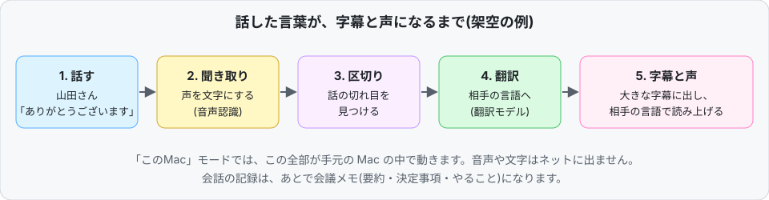
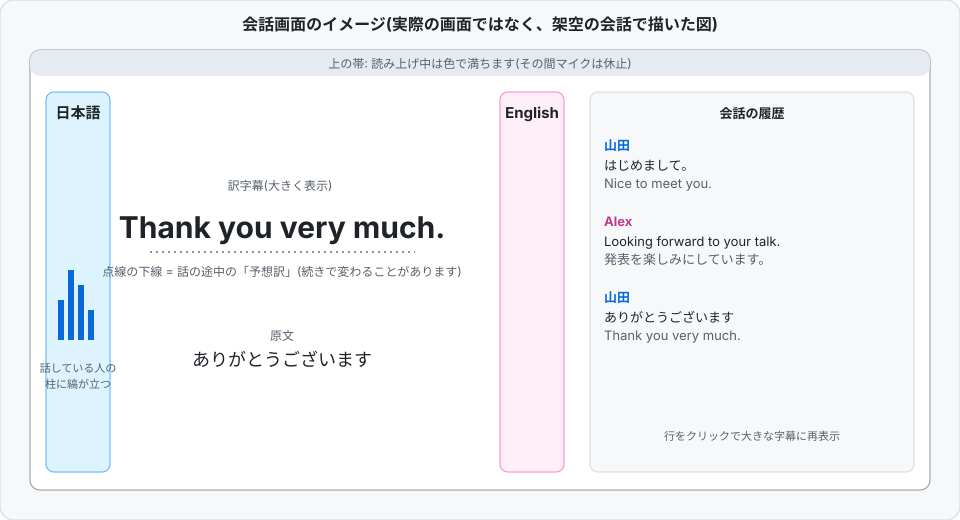
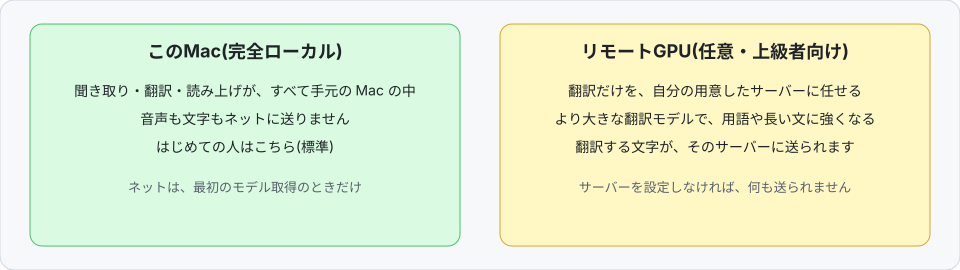
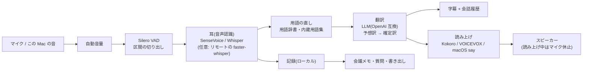

# Sokutsu(即通)

[](LICENSE)
[-lightgrey.svg)](#動作環境)

日本語 | [English](README.en.md)


## これは何?

**外国の人と向かい合って話すとき、話した言葉を Mac が聞き取り、相手の言語の字幕と声にして返すアプリです。** 会議の内容は自動でメモになります。インターネットに音声を送らずに、手元の Mac だけで使えます(Apple シリコンの Mac 専用・無料のオープンソース)。

たとえば、日本語を話す人と英語を話す人が1台の Mac を囲むと、Mac が双方の言葉をその場で訳して、大きな字幕と読み上げで見せます。



> 実際の発話が写り込むため、スクリーンショットは載せていません。図の会話(山田さん・Alex さん)は架空です。

## 目次

- [できること](#できること)
- [画面のイメージ](#画面のイメージ)
- [はじめ方(初めての人向け)](#はじめ方初めての人向け)
- [よくある質問](#よくある質問)
- [用語のやさしい説明](#用語のやさしい説明)
- [もっと詳しく知りたい人へ](#もっと詳しく知りたい人へ)(特長・動作環境・使い方・仕組み・評価の数字・プライバシー・制限事項・開発・ライセンスと謝辞・ロードマップ)

## できること

**留学生や海外のお客さんとの会話**
- 向かい合って交互に話すと、相手の言語の字幕が大きく出ます。
- 読み上げもできるので、字幕を読まなくても聞いて分かります。

**国際学会の質疑・立ち話**
- 質問や答えがその場で字幕になります。専門用語や人名は「用語辞書」に入れておくと、聞き違いや訳のぶれが減ります。

**多言語の会議**
- 話した内容が記録され、会議が終わると要約・決定事項・やることのメモができます(会議の種類を選べます)。
- 記録に質問したり、PDF・Word・字幕ファイルとして書き出したりできます。

対応言語は日本語・英語・中国語・韓国語です(この中から好きな2言語を選びます)。

## 画面のイメージ



- 左右の柱が、向かい合う2人の言語です。話している人の柱が動きます。
- 真ん中に、大きな訳字幕と原文が出ます。点線の下線は、話の途中の「予想訳」です。
- 右側に、会話の履歴が積まれます。

## はじめ方(初めての人向け)

公式のビルド済みアプリ(ダブルクリックで入れられるもの)は、いまのところ配布していません。ターミナルでコマンドを貼り付けて起動する方法を説明します。

### 1. 必要なもの

- Apple シリコンの Mac(M1 以降)、macOS 13.3 以降
- メモリ 16 GB を推奨、空きディスク約 5 GB
- インターネット接続(**最初にモデルを取得するときだけ**。そのあとの会話では不要です)
- Python 3.10 以上と、翻訳用のアプリ [LM Studio](https://lmstudio.ai)



### 2. インストール

ターミナル(アプリケーション > ユーティリティ > ターミナル)を開き、1行ずつ貼り付けて Enter を押します。

```sh
git clone https://github.com/hamadareo/sokutsu.git
```
→ このアプリのソースコードをダウンロードします。

```sh
cd sokutsu
```
→ ダウンロードしたフォルダに移動します。

```sh
python3 -m venv .venv
```
→ このアプリ専用の Python の置き場(仮想環境)を作ります。

```sh
.venv/bin/pip install -r requirements.txt
```
→ 必要な部品(ライブラリ)をその置き場に入れます。

```sh
bash scripts/get_models.sh
```
→ 聞き取り・区切り・読み上げのモデル(合計で約 2 GB)を取得します。初回だけです。

### 3. 翻訳の準備(LM Studio)

1. [LM Studio](https://lmstudio.ai) をインストールして開きます。
2. Gemma 3 4B 系のモデルをダウンロードします。
3. サーバーを起動します(ポートは 1234)。

### 4. 起動

```sh
./run.sh
```
→ アプリを起動します。初回は macOS がマイクの許可を聞くので「許可」を選びます。

### 5. 最初の画面で選ぶもの

1. **言語ペア**: 話す2人の言語を選びます(例: 日本語と English)。
2. **翻訳の処理場所**: はじめての人は **「このMac」** を選びます。「リモートGPU」は、自分で用意したサーバーがある人向けです。「自動」はリモートを先に試し、届かなければこの Mac を使います。
3. **聞く音**: 対面なら「マイクだけ」。オンライン会議の相手の声も訳したいときは「マイク + この Mac の音」(macOS 14.2 以降)。
4. 必要なら、テーマ・人名・専門用語の欄や会議の種類を入れて、**「会話を始める」** を押します。

### うまくいかないとき

- **翻訳されない・エラーになる**: LM Studio でモデルを読み込み、サーバー(ポート 1234)を起動してから `./run.sh` を実行したか確かめてください。
- **マイクが反応しない**: システム設定 > プライバシーとセキュリティ > マイク で、ターミナルを許可します。
- **日本語の声が macOS 標準の声になる**: 追加の声エンジン(VOICEVOX)が無いときの動作で、異常ではありません。入れ方は下の「ソースから動かす」にあります。
- **「この Mac の音」が使えない**: clang(`xcode-select --install`)が無いと作れません。マイクだけなら無くても動きます。
- **訳が遅い**: メモリ 8 GB でも動きますが、遅くなります(16 GB を推奨)。
- 上で解決しないときは、下の「もっと詳しく知りたい人へ」の「制限事項」も見てください。

## よくある質問

**Q. 無料ですか?**
A. 無料です。ソースコードは MIT ライセンスです。使うモデルにはそれぞれの利用条件があります(例: Gemma は Google の Gemma Terms of Use)。一覧は [THIRD_PARTY_NOTICES.md](THIRD_PARTY_NOTICES.md) にあります。

**Q. 音声はインターネットに送られますか?**
A. 「このMac」モードでは送られません。ネットを使うのは、モデルの取得のときだけです。クラウドの API は使いません。「リモートGPU」を選んだときだけ、翻訳する文字(リモートの聞き取りを使う場合は音声も)が、自分で指定したサーバーに送られます。

**Q. どの言語に対応していますか?**
A. 日本語・英語・中国語・韓国語です。この中から2言語を選びます。2言語以外の言葉が聞こえたときは、字幕だけを自動で出します。

**Q. 精度はどのくらいですか?**
A. 目安として、日英中韓の12方向で測った翻訳の質(chrF)は 39.03 / 39.34(このMac、2回)でした。リモートGPU(大きめのモデル)では 45.03 / 45.06 です。専門用語が訳に出た割合は、このMacで 93.6% でした。人が読んだときの質に近い指標(COMET)では、平均 87.83でした。**開発者の Mac(主に M3・16 GB)で測った数字で、機材や条件で変わります。** 4人が重なって話す実際の会議には弱く、対面で交互に話す会話向けです。詳しくは「評価の数字」へ。

**Q. どのくらい速いですか?**
A. 目安として、日本語から英語で、話し終えてから訳が確定するまでが中央値で約 0.85 秒、声が鳴り始めるまでが約 1.56 秒でした(開発者の Mac での実測)。

**Q. Windows や iPhone で使えますか?**
A. 使えません。Apple シリコンの Mac 専用です(Windows・Linux・Intel Mac は対象外)。

**Q. 「リモートGPU」とは何ですか?**
A. 翻訳だけを、自分で用意した別のコンピューター(GPU を積んだサーバー)に任せる、上級者向けの任意の機能です。より大きな翻訳モデルを使えるので、専門用語や長い文に強くなります。設定しなければ使われず、何も送られません。

**Q. オンライン会議(Zoom など)でも使えますか?**
A. 使えます。聞く音で「マイク + この Mac の音」を選ぶと、相手の声も訳せます(macOS 14.2 以降)。ただし、読み上げ中はマイクを休止するので、オンライン会議では「字幕だけ」にするのがおすすめです。

**Q. 会話の記録はどこに残りますか?**
A. この Mac の中だけです(ソースから動かす場合は `logs/` フォルダ)。外部には送られず、Git にも入りません。録音を残さない設定もあります。

## 用語のやさしい説明

| 用語 | 意味 |
|---|---|
| 音声認識(耳) | 声を文字にする仕組み。このアプリでは SenseVoice や Whisper を使います。 |
| 翻訳モデル | 文章を別の言語に訳す AI。このアプリでは Gemma 3 4B などの大規模言語モデル(LLM)を使います。 |
| 予想訳 | 相手がまだ話している途中に、先に出しておく仮の訳。話し終えると確定訳に置き換わります。 |
| VAD(区切り) | 声がある部分と無い部分を見分けて、話の切れ目を見つける仕組み。 |
| 量子化(QAT / Q4_0) | AI モデルのサイズを小さくして、少ないメモリで速く動かす工夫。 |
| chrF・COMET | 翻訳の質を測る点数。chrF は文字の一致度、COMET は意味が合っているかを AI で採点します。高いほど良い点数です。 |
| WER(単語誤り率) | 聞き取った文字のうち、間違っていた単語の割合。低いほど良い点数です。 |
| リモートGPU | 翻訳を任せる、自分で用意した別のサーバー。 |
| OpenAI 互換サーバー | LM Studio などが提供する、翻訳モデルを呼び出すための標準的な窓口。クラウドの OpenAI とは関係なく、手元で動きます。 |
| SSH | 別のコンピューターへ、暗号化してつなぐ仕組み。リモートGPUとの接続に使います。 |

---

## もっと詳しく知りたい人へ

ここから先は、仕組み・評価・開発者向けの詳しい内容です。

### 特長

- **字幕が主役**: 大きな訳字幕 + 原文 + 右レールの会話履歴。話している間は点線の下線つきの「予想訳」を先に出し、言い終わると確定します。
- **声でも返す**: 相手の言語で読み上げ(言語ごとに声と速さを選べる)。話のペースに合わせて読み上げ速度を自動で調整するモードもあります。読み上げ中はマイクを休止して自分の声を拾いません(オンライン会議では「字幕だけ」がおすすめ)。
- **言語の自動判別**: 声から言語を判別し、ペアの相手の言語へ訳します。
- **専門用語・人名に強い**: 内蔵の用語集(ja/en/zh/ko)と自分の「用語辞書」・テーマ欄を使って、聞き違い(英字の略語がカタカナ読みになる等)を直し、訳語をそろえます。
- **会議メモ**: 会議の種類(定例・1on1・商談・面接・講義・ブレスト・Q&A)に合わせて、要約・決定事項・やること・話者の名前をローカルの LLM で作ります。会議の途中でもメモを更新できます。
- **会議に質問**: 記録に根拠の行つきで質問できます(1会議/全会議)。フォローアップのメールや議事録の下書きも作れます。
- **記録の整理と書き出し**: フォルダ・タグ・スター・検索。PDF / Word(.docx) / Markdown と、字幕(SRT / WebVTT)で書き出せます。
- **録音・音声ファイルの取り込み**: 会議の録音(任意)を行から再生。m4a・mp3・wav・mp4・mov などの音声・動画から、書き起こし・話者・会議メモを作れます。
- **話者の見分けと「声を覚える」**: 話者を区別し、名前を付けた声を覚えて次の会議から自動で名前を付けます(声の特徴はこの Mac の中だけ)。
- **オンライン会議の相手の声を聞く**: 「マイク + この Mac の音」で Zoom などの音声も訳せます(macOS 14.2 以降)。
- **カレンダー・リマインダー連携**(ボタンを押したときだけ): 予定の題・出席者を会議の候補に、「やること」をリマインダーへ。
- 画面は日本語・英語・中国語・韓国語。投影モード(明るい会場向け)あり。

### 動作環境

- **Apple シリコンの Mac**(M1 以降)、**macOS 13.3 以降**(オンライン会議の相手の声を聞く機能は 14.2 以降)
- メモリ: 16 GB を推奨(8 GB でも動きますが遅くなります)。開発・検証は 16 GB の Mac で行いました。
- 空きディスク: 約 5 GB(モデルは約 3.4 GB)
- ソースから動かす場合: Python 3.10 以上(3.10 で確認)、clang(`xcode-select --install`。この Mac の音を聞く小さな部品を作るのに使います。無くてもマイクだけで動きます)
- 翻訳エンジン(どちらか):
  - ソースから動かす場合の「このMac」: ポート 1234 の OpenAI 互換サーバー(例: [LM Studio](https://lmstudio.ai) に Gemma 3 4B などを入れてサーバーを起動)
  - 配布用アプリを自分でビルドした場合: 翻訳エンジン(llama.cpp の llama-server + Gemma 3 4B)が同梱され、LM Studio は不要です(後述)

### はじめ方

公式のビルド済みアプリ(DMG)は、いまのところ配布していません。ソースから動かすか、自分で DMG を作ってください。

#### ソースから動かす

```sh
git clone https://github.com/hamadareo/sokutsu.git
cd sokutsu
python3 -m venv .venv
.venv/bin/pip install -r requirements.txt
bash scripts/get_models.sh   # 音声認識・VAD・読み上げのモデルを models/ に取得(初回のみ)
./run.sh
```

- モデルは公式の配布元から取得します(Hugging Face の `ggerganov/whisper.cpp`、GitHub の `k2-fsa/sherpa-onnx` のリリース、`snakers4/silero-vad`)。合計で約 2 GB です。取得元と各ライセンスは [THIRD_PARTY_NOTICES.md](THIRD_PARTY_NOTICES.md) にあります。
- 翻訳用の LLM は別に用意します。LM Studio で Gemma 3 4B 系のモデルを入れ、サーバー(ポート 1234)を起動してから `./run.sh` を実行してください。モデルの id は `config.json` の `model`(または環境変数 `TSUYAKU_MODEL`)で指定でき、見つからなければサーバーの最初のモデルを使います。
- 日本語の声に [VOICEVOX ENGINE](https://voicevox.hiroshiba.jp/) を使う場合は、`~/voicevox` に展開してください(場所は `VOICEVOX_HOME` で変更)。無ければ macOS 標準の `say` になります。`TSUYAKU_NO_VOICEVOX=1 ./run.sh` で使わない指定もできます。
- 初回は macOS がマイクの許可を聞きます。「許可」を選んでください。

#### リモートGPU(任意)

自分の推論サーバー(GPU 機など)がある場合は、翻訳だけをそちらへ逃がせます。

1. サーバーで OpenAI 互換の LLM サーバー(llama-server など)を起動しておく(既定ポート 9931。`TSUYAKU_REMOTE_PORT` で変更)。
2. 鍵認証で SSH できるようにして、`TSUYAKU_SSH=user@host ./run.sh` で起動する。`scripts/remote_tunnel.sh` が SSH 転送(この Mac の 127.0.0.1:12345 → サーバー)を貼ります。
3. 起動画面の「翻訳の処理場所」で「リモートGPU」か「自動」(リモートを先に試し、届かなければこの Mac)を選びます。

任意で、音声認識もサーバーに任せられます(`server/remote_stt_server.py`、faster-whisper を入れた venv が必要。`remote_tunnel.sh` が配置・起動・転送します)。**この場合、翻訳する音声がサーバーへ送られます**(SSH で暗号化)。サーバーのアドレスや認証情報はこのリポジトリに含まれません。

#### 配布用アプリ(DMG)を自分でビルドする

```sh
bash scripts/build_dist.sh   # dist/Sokutsu-<版>.dmg ができる(Apple シリコン、macOS 13.3 以上)
```

同梱の Python 3.12 + 依存、llama.cpp の llama-server(翻訳は Gemma 3 4B)、起動役、この Mac の音の部品が入ります。モデル(約 3.4 GB)は DMG に入れず、初回起動の画面で公式の配布元から取得します(SHA256 を確かめ、途中から再開できます)。署名は ad-hoc(公証なし)です。詳細は `packaging/` と `scripts/build_dist.sh` を見てください。自分の名前やホスト名がビルドに紛れ込んでいないかを最後に確かめたいときは、環境変数 `SOKUTSU_FORBIDDEN_WORDS`(コンマ区切り)にそれらを入れてビルドします。

### 使い方

1. **起動画面**: 言語ペアを選び、必要ならテーマ・人名・専門用語の欄や「用語辞書」、会議の種類、議題を入れて「会話を始める」。声と速さ・翻訳の処理場所・聞く音(マイクだけ / マイク + この Mac の音)もここで選びます。
2. **会話画面**: 左右の端の柱が向かい合う2人の言語で、話している人の柱に声の縞が立ちます。中央に大きな訳字幕と原文、右のレールに会話の記録が積まれます。上の帯が色で満ちている間は読み上げ中で、マイクは休止しています。点線の下線は予想訳で、話の続きで変わることがあります。「投影」ボタンで明るい会場向けに文字と線を濃くできます。
3. **会議を終える**: 録音を止めて会議メモを作り、会議の画面を開きます(アプリは閉じません)。

#### 主なショートカットと操作

| 操作 | 内容 |
|---|---|
| `Space` / 字幕をクリック | 読み上げを止めて、すぐ聞き始める |
| `Esc` | 読み上げ・翻訳中は中止。何もしていないときはアプリを終了 |
| `-` / `+`(または A− / A＋) | 字幕の大きさ |
| `V` | 読み上げのあり・なし(字幕だけ)を切り替え |
| `B`、続けて `1`〜`4` | 今の発言に印を付け、種類を選ぶ(重要・決定・やること・質問)。`Shift`+`B/Q/D/T` で種類を直接指定 |
| `M` | 自分のメモを書く(`Enter` で追加) |
| `?` | 操作の早見を開く・閉じる |
| 記録の行をクリック | その発言をもう一度大きな字幕に出す |
| 記録の行をダブルクリック | 聞き取りの誤りをその場で直す |
| 下の帯の「応答」 | 直近の発話の応答速度の内訳(聞き取り・翻訳・声) |

#### 右クリック

会議の記録の行・メモの項目・一覧のフォルダなどで右クリックのメニューが出ます。文を直す、話者を変える、印を付ける、項目を消す・元に戻す(`⌘Z`)などができます。

#### 会議メモ

会議を終えると、選んだ種類に合わせた観点で要約・決定事項・やること・質問・キーワードと、会話から当てた話者の名前を作ります(根拠の発言も残します)。種類はあとから変えて作り直せます。会議の一覧ではフォルダ・タグ・スター・検索が使え、PDF・Word・Markdown・字幕(SRT / WebVTT)へ書き出せます。「会議に質問」では、答えの各文に根拠の行番号が付き、押すと記録のその行へ飛びます。

#### 用語辞書

起動画面の「用語辞書」(またはテーマ欄)に、人名・社名・専門用語を登録すると、聞き取りの文字の直しと翻訳の訳語の指定に使われます。内蔵の用語集(約 3,800 項目、日英中韓)と合わせて、その発話に出てくる語だけを翻訳の依頼に短く足します。

#### 設定ファイル

`config.json`(リポジトリ直下。無くても可。Git には入りません)で `src/tsuyaku/config.py` の `Settings` を上書きできます。環境変数 `TSUYAKU_HOST` / `TSUYAKU_PORT` / `TSUYAKU_MODEL` は `config.json` より後に効きます。

```json
{ "model": "google/gemma-3-4b", "tts_ja_engine": "say", "min_silence_s": 0.6 }
```

配布用アプリでは `~/Library/Application Support/Sokutsu/config.json` で、`"server_url": "http://<host>:<port>"`(OpenAI 互換の `/v1` サーバー)を足すと「自分のサーバー」の選択肢が出ます。

### 仕組み

耳 → 翻訳 → 声 のパイプラインです。



- **耳**: 既定は SenseVoice-Small(sherpa-onnx、1区間あたり約 0.15 秒)。Whisper large-v3-turbo(whisper.cpp)は精度重視の選択肢で、1区間あたり約 2.4 秒です(開発機の M3 での目安)。リモートの耳を使う設定では、確定をリモートの faster-whisper が聞き、遅いときはこの Mac の耳の結果で予想訳を先に出します。
- **翻訳**: OpenAI 互換の LLM サーバーを呼びます。直前の発話を文脈に添え、断片・短文・長文それぞれの失敗(原文に無い内容の付け足し、長文の抜け)を防ぐための確認と再試行があります。話の途中で予想訳を作っておき、当たれば確定を待たずに出します。
- **声**: Kokoro(英・中など)、VOICEVOX(日本語、任意)、macOS 標準の `say`。訳が長いときは速さを自動で上げ、追いつけない文は飛ばして字幕だけにします。
- **区切り・ガード**: 区間の切り方、聞き違い・幻聴(雑音を言葉にしてしまう誤認識)を捨てるガード、自分の読み上げを拾わないガードがあります。

### 評価の数字

すべて開発中に自分の Mac で測った**実測値**で、再現手順は `scripts/eval_*.py` と [eval/README.md](eval/README.md) にあります。条件が違う数字を同じ表に並べないよう、条件を添えます。測った機材は主に M3・16 GB の Mac です。数字は機材・負荷・ネットワークで動くので、目安として見てください。

**翻訳の質(同梱の Gemma 3 4B 系)** — 日英中韓の12方向、公開の並行コーパス FLEURS(CC BY 4.0)の 30 文の chrF と、作った用語テスト(74 項目 × 12 方向 = 888 訳)で用語が訳に出た割合:

| 翻訳エンジン | chrF(FLEURS 30 文 × 12 方向) | 用語が訳に出た割合(888 訳) |
|---|---|---|
| このMac(Gemma 3 4B) | 39.03 / 39.34(2回) | 93.6% |
| リモートGPU(Qwen 系モデル) | 45.03 / 45.06(2回) | 98.3% |

**COMET(wmt22-comet-da)** — 同梱の Gemma 3 4B QAT Q4_0 を、アプリと同じ依頼で 1,106 訳(FLEURS・IT 用語・作った対話・短文/断片の4種のセット)に通した平均は **87.83**(セット別: 86.04 / 88.13 / 88.54 / 90.72)。長さの再試行と指示文の例を足す前の同じ4セットの平均は 87.43 でした。

**応答の速さ(このMac、日→英、決まった速さ)** — 作った対訳 18 文を合成音声で実時間に流し、話し終わりから測った秒(中央 / p90):

| 訳の確定 | 声の鳴り始め |
|---|---|
| 0.85 / 1.69 秒 | 1.56 / 2.55 秒 |

日→中でも訳の確定 0.82 / 1.9 秒、声 1.14 / 2.07 秒でした(いずれも LM Studio の Gemma 3 4B、11/08 時点のビルド)。リモートGPU 構成では日→中の訳の確定が 1.16 / 2.35 秒、声が 1.77 / 2.81 秒でした。**速い掛け合い(話速 ×1.3・間 0.6〜0.9 秒)では、リモート構成で読み上げが追いつかず 18 文中 4〜7 文を飛ばしました**(字幕は出ます)。

**実会議(英語・AMI コーパス 8 クリップ × 3 分、リモート構成、実時間)** — 4人の重なりが多い実会議では、確定字幕の遅れが中央 4.93 秒 / p90 10.24 秒、確定字幕の単語誤り率(WER)は 38.5%、正解の単語のうち確定字幕に出た割合は 57.7% でした。対面の2人会話向けに作っており、複数人の同時発話にはまだ弱いです。

### プライバシー

- **「このMac」モードでは、音声・文字・翻訳はすべて Mac の中で処理し、外部のネットワークには送信しません。** ネットワークに出るのは、モデルのダウンロード時だけです(公式の配布元)。クラウドの API は使いません。
- 「リモートGPU」を選んだ場合に限り、翻訳する文字(とリモートの耳を使う場合は音声)が、**自分で指定したサーバー**へ SSH 転送で送られます。サーバーを設定しなければ何も送られません。
- 会話の記録・設定・用語・録音(任意)・覚えた声の特徴は、この Mac のローカルにだけ保存します(ソースから動かす場合はリポジトリ直下の `logs/` と `config.json`、配布用アプリでは `~/Library/Application Support/Sokutsu/`)。これらは `.gitignore` で Git から外してあります。録音を残さない設定もあります。
- カレンダー・リマインダーは、ボタンを押したときだけ読み書きします。

### 制限事項

- 対面で交互に話す会話を想定しています。同時に話す・相づちが重なる会話は精度が落ちます(上の AMI の数字を参照)。
- 翻訳の質は選ぶ LLM に依存します。同梱の 4B クラスのモデルは、リモートの大きなモデルより用語・長文で劣ります(上の表)。固有名詞や専門用語は、用語辞書・テーマ欄に入れると改善します。
- 対応は日本語・英語・中国語・韓国語です。韓国語の読み上げは macOS 標準の声に落ちることがあります。
- ビルド済みのアプリは配布していません。ソースからの実行には Python 環境と別途の翻訳 LLM サーバー(LM Studio など)が要ります。
- Apple シリコンの macOS 専用です。Windows / Linux / Intel Mac は対象外です。
- 読み上げ中は相手の声を聞けません(マイク休止)。オンライン会議では「字幕だけ」を推奨します。
- 配布用アプリは ad-hoc 署名で、Apple の公証を受けていません。最初の起動だけ「右クリック → 開く」(macOS 15 以降は設定の「このまま開く」)が必要です。

### 開発

```sh
PYTHONPATH=src .venv/bin/python -m unittest discover -s tests
```

- 単体テストは 1,000 件以上あります(音声認識・翻訳・画面の部品など。マイクや実機の音声は使いません)。`models/silero_vad.onnx` が無いと、VAD を使う一部のテストはスキップされます(`scripts/get_models.sh` で取得)。
- マイク無しで WAV を通す E2E: `PYTHONPATH=src .venv/bin/python scripts/e2e_file.py <16k mono wav> --pair ja-en --topic テーマ`
- 評価: `scripts/eval_*.py`(使い方は [eval/README.md](eval/README.md))。評価に使う会話音声は含めず、スクリプトで作り直します。
- ブランチの方針: `main` は常に動く状態に保ちます。変更は機能ごとのブランチで行い、変更の前後を同じ条件の評価で比べて、下がらないことを確かめてから `main` に入れます。見つけた問題 → 変更 → 設計 → 作り方 → 結果を、コミットメッセージやコードのコメントに残します。
- ソースの構成: `src/tsuyaku/`(Python 本体と `webui/` の画面)、`native/`(C の小さな部品: この Mac の音を聞く部品・エコー除去・起動役)、`server/`(リモートの耳の HTTP サービス)、`scripts/`(起動・ビルド・評価)、`packaging/`(DMG のビルド)、`tests/`、`eval/`。

### ライセンスと謝辞

Sokutsu のソースコードは [MIT License](LICENSE) です(著作者: Sokutsu contributors)。

同梱・利用するモデルとソフトウェアにはそれぞれのライセンスがあります。一覧は [THIRD_PARTY_NOTICES.md](THIRD_PARTY_NOTICES.md) にあります。特に、Gemma は Google の [Gemma Terms of Use](https://ai.google.dev/gemma/terms)、SenseVoice は FunASR Model Open Source License の条件で使います。

謝辞: [whisper.cpp](https://github.com/ggml-org/whisper.cpp) / [Whisper](https://github.com/openai/whisper)(OpenAI)、[llama.cpp](https://github.com/ggml-org/llama.cpp)、[sherpa-onnx](https://github.com/k2-fsa/sherpa-onnx)、[SenseVoice](https://github.com/FunAudioLLM/SenseVoice)、[Kokoro](https://huggingface.co/hexgrad/Kokoro-82M)、[Silero VAD](https://github.com/snakers4/silero-vad)、[3D-Speaker](https://github.com/modelscope/3D-Speaker)、[VOICEVOX](https://voicevox.hiroshiba.jp/)、[Gemma](https://ai.google.dev/gemma)、[FLEURS](https://huggingface.co/datasets/google/fleurs) と [AMI コーパス](https://groups.inf.ed.ac.uk/ami/corpus/)(評価に使用)、pywebview ほか多くのオープンソースの作者の皆さん。

### ロードマップ

- ビルド済みアプリ(DMG)の公開(署名・公証を含む)
- 複数人の同時発話・遠い声(卓上マイク)への強化
- イヤホンで人別に訳を聴くモード
- 翻訳エンジンの選択肢を増やす(サーバー側の設定を画面から)
- 対応言語の追加
- 評価セットの拡充(作った対話の追加、実会議に近い条件)
